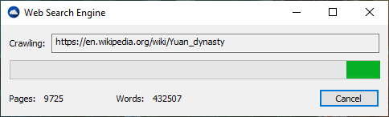

# WebSearchEngine

Design and implementation of a **Web Search Engine** using _Text Mining techniques_.

## Introduction

_WebSearchEngine_ is a free (as in “free speech” and also as in “free beer”) web crawler, indexer and search engine built around text-mining ideas. Running in the Microsoft Windows environment, its use is governed by [GNU General Public License v3.0](https://www.gnu.org/licenses/gpl-3.0.html). A C++/MFC desktop application crawls web pages, extracts their title and plain text, and stores the words they contain in a MySQL/MariaDB database through ODBC. Stored SQL functions weigh every word of every page with a TF-IDF style score, and a small PHP page answers search queries by ranking the indexed pages with these scores. A Python version of the crawler is included as well. This is a learning and demonstration project rather than a production search engine, so please read [Known limitations](#known-limitations) before you point it at the web. The accompanying article is on [CodeProject](https://www.codeproject.com/articles/Web-Search-Engine).

## How it works

1. **Crawl**: the crawler starts at `https://en.wikipedia.org/` and keeps a _frontier_ of the URLs it still has to visit. Whenever a link is found again its score grows by one, and the next page to download is the queued URL with the highest score (the one queued first wins a tie). Pages are downloaded to a temporary file with `URLDownloadToFile`.
2. **Parse**: the title is read from the `<title>` element, and the links found in `<a href="…">` elements are resolved against the address of the page, stripped of their `#fragment` and added to the frontier. The HTML is converted to plain text: only the content of `<body>` is kept, and `script`, `noscript`, `style` and `object` elements and comments are left out.
3. **Index**: the text is lower-cased and split into words at spaces and punctuation. Each distinct word is stored once in the `keyword` table, and the `occurrence` table counts how many times it appears on each page.
4. **Score**: every 1,000 stored pages the crawler recomputes, with the `data_mining` SQL function, the relevance scores of the words it has met since the previous round (see [Relevance scoring](#relevance-scoring)).
5. **Search**: `search.php` splits the query into words, keeps the pages that contain **all** of them, ranks these pages by the average score of the query words and shows the best 100, each with its title, score, address and the beginning of its text.

## What is in the repository

| Component | Files | Role |
| :--- | :--- | :--- |
| C++/MFC crawler | `WebSearchEngine.cpp`, `WebSearchEngineDlg.cpp`, `WebSearchEngineExt.cpp`, `ConnectionSettingsDlg.cpp` | Application and main dialog with the crawling thread, crawler engine (frontier, download, parsing, indexing), database connection settings |
| HTML processing | `HtmlToText.cpp`, `UnquoteHTML.cpp` | HTML to plain text conversion and HTML entity decoding |
| Third-party classes | `ODBCWrappers.h`, `HLinkCtrl.cpp`, `VersionInfo.cpp` | PJ Naughter's ODBC wrappers, hyperlink control and version information classes |
| Database | `search.sql` | Stored functions `no_of_words`, `no_of_pages`, `total_pages` and `data_mining` |
| Web front-end | `index.html`, `search.php` | Search form and results page |
| Python crawler | `WebSearchEngine.py` | Stand-alone alternative to the C++ crawler |
| Documentation | `README.md`, `WebSearchEngine.html`, `ReleaseNotes.html`, `SoftwareContentRegister.html` | Overview, help page, release history, third-party software |

## Getting started

### Prerequisites

- **Windows** with **Visual Studio 2026** (the project uses the `v145` platform toolset), the **Desktop development with C++** workload and the **MFC** component. To build with another Visual Studio version, retarget the project to a toolset you have installed.
- The **MySQL Connector/ODBC 8.0** series ([downloads](https://dev.mysql.com/downloads/connector/odbc/)): the connection string asks for the driver named `MySQL ODBC 8.0 Unicode Driver`. Install the same bitness (x64 or x86) as the build you are going to run.
- **MariaDB 10.1.3 or later**, because `search.sql` uses `CREATE OR REPLACE FUNCTION`. MySQL does not support that statement; to use MySQL, replace each one with `DROP FUNCTION IF EXISTS …` followed by `CREATE FUNCTION …`.
- A web server with **PHP** (7 or 8) and the `mysqli` extension, for the search page.
- **Python 3** with `mysql-connector-python`, `beautifulsoup4` and `gensim`, only if you prefer the Python crawler.

### 1. Prepare the database

Create an empty database and an account for the crawler, for example:

```sql
CREATE DATABASE TextMining;
CREATE USER 'crawler'@'localhost' IDENTIFIED BY '<a-strong-password>';
GRANT ALL PRIVILEGES ON TextMining.* TO 'crawler'@'localhost';
```

Then load the stored functions of `search.sql` into it. The first statement of that file (`CREATE UNIQUE INDEX …`) is run by the crawler itself once the tables exist, so skip it, or let it fail harmlessly with the `--force` option of the command-line client (run it from `cmd.exe` or a Unix shell, because PowerShell does not support `<`):

```bash
mysql --force -u crawler -p TextMining < search.sql
```

`SHOW FUNCTION STATUS WHERE Db = 'TextMining';` must list `no_of_words`, `no_of_pages`, `total_pages` and `data_mining`. The C++ crawler calls them for the first time when it stores its 1,000th page and stops with the error “Cannot apply data mining to the database” if they are missing.

### 2. Build and run the crawler

Open `WebSearchEngine.sln` in Visual Studio, or build from a Developer Command Prompt:

```bash
msbuild WebSearchEngine.vcxproj /p:Configuration=Release /p:Platform=x64
```

`Debug` and `Release` are available for both `x64` and `Win32`, and the executable is written to `x64\Release` (or `Release` for `Win32`). The repository does not contain compiled binaries, so you build the application yourself.

Run `WebSearchEngine.exe`. It first shows the **Database Connection Settings** dialog (**Server**, **Port**, **Database**, **Username** and **Password**; the defaults are `localhost`, `3306`, `TextMining` and `root`). The settings are remembered for the current Windows user under `HKEY_CURRENT_USER\Software\Stefan-Mihai MOGA`, and the password is saved there as plain text.

> [!WARNING]
> Every time it starts, the crawler **drops and re-creates** the `occurrence`, `keyword` and `webpage` tables, so the index of any previous run is lost. Use a database that holds nothing else you care about.

Then it creates the tables, together with a unique index on `keyword(name)`, and starts crawling in a background thread. The dialog shows the address being crawled and the number of **Pages** and **Words** stored so far. The crawl ends when there are no URLs left to visit, or when you press **Cancel**.

### 3. Publish the search page

Copy `index.html` and `search.php` to a web server with PHP and the `mysqli` extension, and edit `search.php` so that `$servername`, `$username`, `$password` and `$dbname` point to your own database. The page only reads data, so give it an account that has just the `SELECT` privilege, and keep these credentials out of version control. Then open `index.html`, type a query and search.

### Alternative: the Python crawler

`WebSearchEngine.py` does the same job without Visual Studio, ODBC or `search.sql`: when it starts, it drops and re-creates the tables, adds a `frontier` table and creates the four stored functions itself.

```bash
pip install mysql-connector-python beautifulsoup4 gensim
```

Set `HOSTNAME`, `DATABASE`, `USERNAME` and `PASSWORD` at the top of the script (and keep your real values out of version control), then run `python WebSearchEngine.py`. Compared with the C++ crawler:

- the frontier lives in the `frontier` table, and the crawl ends when no unvisited URL is left;
- links that end with one of dozens of non-HTML file extensions (archives, images, audio, video, documents, fonts, executables and so on) are not queued;
- the text is split with Gensim's tokenizer, and the words made only of ASCII letters and digits are indexed;
- every 1,000 stored pages, the scores of all the words are refreshed.

## Data model

| Table | Columns | Purpose |
| :--- | :--- | :--- |
| `webpage` | `webpage_id`, `url`, `title`, `content` | One row per crawled page (the C++ crawler keeps at most 65,535 characters of text) |
| `keyword` | `keyword_id`, `name` | One row per distinct word, with a unique index on `name` |
| `occurrence` | `webpage_id`, `keyword_id`, `counter`, `pagerank` | How many times a word appears on a page (`counter`) and the relevance score of that word on that page (`pagerank`) |
| `frontier` | `url_id`, `address`, `visited`, `score` | Python crawler only: the URLs waiting to be crawled (the C++ crawler keeps its frontier in memory) |

## Relevance scoring

For every word of every page, the `data_mining` function of `search.sql` computes:

```
score(page, word) = counter(page, word) / no_of_words(word)
                    * LOG((1 + total_pages()) / no_of_pages(word))
```

`counter` is the number of times the word appears on the page, `no_of_words` is the highest `counter` of that word on any page, `total_pages` is the number of indexed pages and `no_of_pages` is the number of pages that contain the word. The first factor is the term frequency and the second one the inverse document frequency (`LOG` is the natural logarithm), so a word that is frequent on a page but rare in the index weighs the most. The score is stored in `occurrence.pagerank`; despite its name, it has nothing to do with the link-based PageRank algorithm. A search ranks the pages by the average score of the query words.

Scores are computed in batches: every 1,000 stored pages, the C++ crawler refreshes the scores of the words it has met since the previous batch, and the Python crawler refreshes all of them. They are therefore approximate while a crawl is running, and the pages stored after the last batch keep the score 0, because nothing is recomputed when the crawl ends.

## Known limitations

- **No `robots.txt`, no politeness**: neither crawler reads `robots.txt` or pauses between requests, and both start from `https://en.wikipedia.org/`. Only crawl sites you are allowed to crawl, at a rate their owners accept.
- **A fresh index on every start**: both crawlers drop the existing tables, and the C++ crawler keeps its frontier in memory, so a stopped crawl cannot be resumed.
- **English-oriented parsing in the C++ crawler**: only the words made of the letters a–z are indexed (numbers, accented and non-Latin words are dropped), a page is skipped unless it has a plain `<title>…</title>` element, only the links written exactly as `<a href="…">` are followed, and the content type is not checked.
- **Speed**: each crawler runs a single crawling thread, and the C++ crawler scans its frontier, visited URLs and known words linearly, so it slows down as they grow.
- **Windows only**: the C++ crawler needs Windows (MFC and ODBC), while the PHP page and the Python crawler run elsewhere as well.
- **Credentials and security**: the C++ application saves the database password as plain text (the optional encryption code, `USE_CRYPTO_METHODS`, is switched off), and `search.php` and `WebSearchEngine.py` keep the database credentials in the source. `search.php` is a demonstration: it builds its SQL statement from the query text and prints titles, addresses and page text without escaping them, and the Python crawler formats its SQL statements as strings. Review and harden them before you expose them to untrusted users, never commit real credentials, and report vulnerabilities as described in [SECURITY.md](SECURITY.md).

## Roadmap

This roadmap outlines where _WebSearchEngine_ is heading. Today it is a crawler, an indexer and a small search page that show how text mining can rank web pages, and the roadmap builds on that: it brings together the next steps for the features that are already there, ideas for new ones, and the maintenance work that goes into every update. Items are grouped by horizon rather than by date, and their order may change as feedback arrives, so please treat it as a statement of intent, not a promise. For everything that has already shipped, see the [Release Notes](ReleaseNotes.html).

_Last reviewed: November 2026._

### Now (in progress and ongoing)

- **Up-to-date components**: updates keep picking up the latest versions of PJ Naughter's `ODBCWrappers`, `CHLinkCtrl` and `CVersionInfo` classes (the most recent update, of `ODBCWrappers`, was in March 2026) and the latest Visual Studio toolset.
- **Stability, security and performance**: bug fixes, security updates and performance tuning continue alongside new features. Bug reports for different MySQL/MariaDB servers and ODBC driver versions are especially welcome.

### Next (planned, next in line)

- **Respect `robots.txt`**: read and obey the `robots.txt` file of every site (including `Crawl-delay`) and wait between two requests to the same site. Neither crawler does this today.
- **Resumable crawls**: make dropping the tables optional and keep the frontier in the database, as the Python crawler already does, so that a stopped crawl can be continued instead of started over.
- **Configurable start**: choose the start addresses and the limits of a crawl (maximum number of pages, allowed sites) instead of the fixed `https://en.wikipedia.org/`.
- **Final scoring pass**: refresh the relevance scores when a crawl stops, so that the pages stored after the last batch of 1,000 are ranked as well.

### Later (planned, larger efforts)

- **Unicode-aware indexing**: index numbers, accented and non-Latin words (the C++ crawler keeps only the words made of the letters a–z today), and add stop words and stemming.
- **A safer and richer search page**: prepared statements and escaped output in `search.php`, credentials kept outside the script, paging beyond the first 100 results, and a snippet around the matching words instead of the first 1,024 characters of the page.
- **Faster crawling**: hash-based lookups for the frontier, the visited URLs and the known words, and several crawling threads with a per-site limit, so that large crawls do not slow down.
- **Protected settings**: save the database password protected (for example with the Windows Data Protection API) instead of as plain text in the registry.

### Under consideration (ideas, not yet committed)

- **Link-based ranking**: combine the word scores with a score computed from the links the crawler already collects. The `pagerank` column is a TF-IDF score today, not a link-analysis one.
- **Phrase and boolean queries**: quoted phrases and `OR`/`NOT` operators (a query needs all its words today), possibly backed by MariaDB full-text indexes.
- **One schema definition**: share a single definition of the tables and functions between the C++ crawler, the Python crawler and `search.sql` (the same SQL is duplicated in three places today), including a variant of the functions that MySQL accepts.
- **ARM64 and automated builds**: a native ARM64 build (the project is built for x86 and x64 today) and a GitHub Actions workflow that builds every pull request, since there is no continuous integration yet.

### Help shape the roadmap

Want to see something sooner, or have an idea that is not listed here? [Open an issue](https://github.com/mihaimoga/WebSearchEngine/issues) or start a conversation in [Discussions](https://github.com/mihaimoga/WebSearchEngine/discussions). Contributions are welcome as well: any item above can be picked up through a pull request, as described in the next section.

## Create and Submit your Pull Request

The first step is to create an [issue](https://github.com/mihaimoga/WebSearchEngine/issues) on GitHub that describes the bug to fix or the improvement to make; in your issue, be sure to explain that you are going to submit a pull request. The second step is to fork the repository, commit your changes to your fork and use the GitHub interface to create the pull request from your fork into the main repository. The final step is to wait for and respond to feedback from the developers as needed, until such time as your pull request is accepted or rejected. Please follow the [Code of Conduct](CODE_OF_CONDUCT.md), and report any security vulnerability privately, as described in [SECURITY.md](SECURITY.md), instead of opening a public issue.

## Acknowledges

- [CHLinkCtrl](https://www.naughter.com/hlinkctrl.html), [ODBCWrappers](https://www.naughter.com/odbcwrappers.html) and [CVersionInfo](https://www.naughter.com/versioninfo.html): PJ Naughter's hyperlink control, ODBC wrappers and version information classes, used by the C++ application. See the [Software Content Register](SoftwareContentRegister.html) for the details.
- [Bootstrap](https://getbootstrap.com/): the CSS framework used by `index.html`, `search.php` and the HTML documentation pages.
- [Beautiful Soup](https://www.crummy.com/software/BeautifulSoup/), [Gensim](https://radimrehurek.com/gensim/) and [MySQL Connector/Python](https://dev.mysql.com/doc/connector-python/en/): used by the Python crawler.

## Demo

Visit [`text-mining.ro`](https://text-mining.ro/) for a live demonstration.

## License

This project is licensed under the GNU General Public License v3.0 - see the [LICENSE](LICENSE) file for details.
